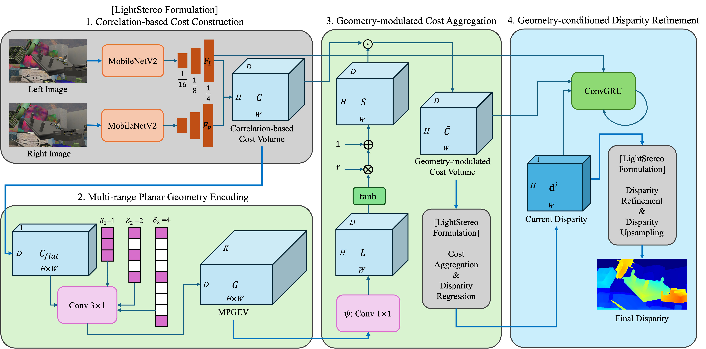
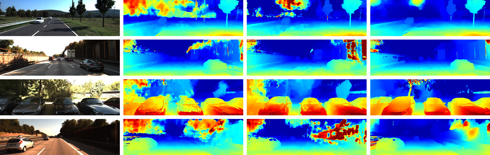
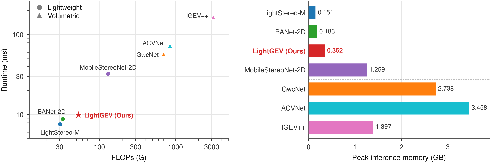
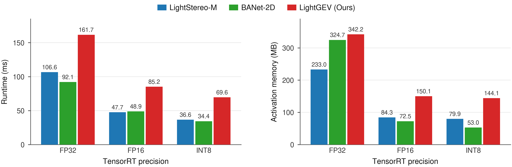

# LightGEV: Lightweight Planar Geometry Encoding Volume for Stereo Matching

Lightweight, geometry-aware stereo matching for robotic and embedded vision. This repository is the extended journal version of my M.S. thesis research at Sejong University (Department of AI and Robotics).

LightGEV is a 2D stereo matching network that adds explicit disparity-axis geometry encoding to a lightweight correlation-based pipeline, with no 3D cost aggregation. The encoded disparity context modulates the correlation cost volume, and the modulated volume then guides both cost aggregation and recurrent disparity refinement. The design targets platforms where accuracy, latency, and memory all matter, and it is validated on a desktop GPU and on an NVIDIA Jetson Orin Nano Super with TensorRT.

> This repository extends the original thesis implementation ([LightGEV](https://github.com/taeinkimkim/LightGEV)). Compared with the thesis version, it reformulates geometry-guided cost modulation as a bounded multiplicative gate, feeds the geometry-modulated cost volume into the recurrent refinement module, and adds ablations, region-wise and resolution-sensitivity analyses, and embedded TensorRT deployment (FP32 / FP16 / INT8).

## My Contributions

- Designed a geometry-aware planar stereo architecture that integrates explicit disparity-axis geometry encoding into both cost modulation and recurrent refinement, without 3D cost aggregation.
- Introduced the Planar Geometry Encoding Volume (PGEV) and its multi-range extension (MPGEV), which encode relationships among disparity hypotheses through dilated disparity-wise filtering (dilations {1, 2, 4}).
- Developed a bounded, geometry-guided multiplicative gating mechanism (`S = 1 + r·tanh(ℓ)`) that rescales correlation responses before aggregation, initialized as an identity so the original cost volume is preserved at the start of training.
- Reduced zero-shot global EPE relative to LightStereo-M by approximately **24.7% on ETH3D** and **13.9% on KITTI**, and achieved lower global EPE than BANet-2D on ETH3D, KITTI, and Middlebury.
- Achieved **9.889 ms (101.1 FPS)** with **52.941 GFLOPs** and **0.352 GB** peak memory on a desktop GPU, which is 5.7–16.7× faster than the evaluated volumetric models.
- Deployed the model with TensorRT on an NVIDIA Jetson Orin Nano Super Developer Kit, reaching **14.4 FPS under INT8** with a 27.3 MB engine.

## Overview

Volumetric stereo networks (e.g. GwcNet, ACVNet, IGEV++) regularize a dense cost volume over height, width, and disparity with 3D convolutions. This gives strong joint spatial and disparity reasoning, but memory and compute grow quickly with resolution and disparity range. Lightweight stereo networks (e.g. LightStereo, BANet-2D, MobileStereoNet-2D) stay efficient by working in 2D, but they model the disparity axis only partially, which leads to unstable predictions on textureless surfaces, thin structures, slanted planes, and occlusion boundaries. Iterative refinement (e.g. RAFT-Stereo) helps correct coarse estimates, but it does not by itself add new geometric context.

LightGEV adds disparity context to the lightweight pipeline and uses it in both the initial estimate and the refinement.

<em>Fig. 1. Model architecture of LightGEV.</em>

1. **Correlation-based cost construction.** A MobileNetV2 backbone extracts left/right features at 1/4 resolution. Following LightStereo, a channel-averaged inner product gives a correlation volume `C ∈ ℝ^{H×W×D}`, which is reshaped to `C_flat ∈ ℝ^{D×(HW)×1}` so that disparity becomes a filterable axis.
2. **Multi-range planar geometry encoding (MPGEV).** Three parallel 3×1 convolution branches with dilations {1, 2, 4} (spans of 3, 5, and 9 disparity bins, M = 5 channels each) filter along the disparity axis. Their outputs are concatenated and fused by a 1×1 convolution into a geometry volume `G ∈ ℝ^{D×(HW)×K}` (K = 16), which keeps a separate descriptor for each disparity hypothesis.
3. **Geometry-modulated cost aggregation.** Each geometry vector is L2-normalized and projected by a 1×1 convolution `ψ` to a gate logit `ℓ`. The bounded gate `S = 1 + r·tanh(ℓ)` (r = 0.75) multiplies the correlation volume, `C̃ = C ⊙ S`. The gate preserves the sign of each response and limits rescaling to `[1 − r, 1 + r]`. The modulated volume goes through the LightStereo cost aggregation and disparity regression stages to produce the initial disparity.
4. **Geometry-conditioned disparity refinement.** A ConvGRU update operator refines the disparity for 6 iterations, `dⁱ⁺¹ = dⁱ + f(dⁱ, F_L, C̃)`, using the geometry-modulated cost volume as input. A LightStereo refinement step and context-aware upsampling then restore full resolution.

All models are trained only on SceneFlow (FlyingThings3D, final pass) and evaluated zero-shot, with no fine-tuning, on Middlebury 2014, ETH3D, KITTI 2012, and KITTI 2015. LightStereo-M is retrained under exactly the same protocol; BANet-2D uses the authors' released SceneFlow checkpoint.

## Results

All numbers are global end-point error (EPE) in pixels; lower is better. Global EPE is computed over the union of the textureless, edge, thin, and thick region masks defined in the paper.

| Dataset | LightStereo-M | BANet-2D | LightGEV (ours) |
|---|---|---|---|
| SceneFlow (in-domain) | 1.123 | **0.982** | 1.016 |
| ETH3D (zero-shot) | 25.725 | 39.130 | **19.378** |
| KITTI 2012 + 2015 (zero-shot) | 5.921 | 5.847 | **5.098** |
| Middlebury 2014, quarter res. (zero-shot) | **4.072** | 4.859 | 4.596 |

- **SceneFlow:** LightGEV improves on LightStereo-M in every region (global EPE −9.5%) but does not surpass BANet-2D in-domain.
- **ETH3D:** LightGEV has the lowest error in every region. Edge EPE drops from 21.550 to 6.827 (≈ −68.3%) and thick-region EPE from 31.285 to 19.010 relative to LightStereo-M.
- **KITTI:** LightGEV has the lowest global and textureless EPE. BANet-2D is lower on edge, thin, and thick regions.
- **Middlebury:** LightGEV beats BANet-2D on global EPE but trails LightStereo-M. Resolution and dilation experiments show that the SceneFlow-selected dilations {1, 2, 4} are not optimal for Middlebury; {1, 4, 8} lowers global EPE at every tested resolution even when pixels with disparity above 192 are excluded.

<em>Fig. 4. KITTI zero-shot comparison. Columns: left image, LightStereo-M, BANet-2D, LightGEV (ours).</em>

### Ablation highlights (SceneFlow, global EPE)

| Component | Setting | Global EPE |
|---|---|---|
| Modulation range `r` (aggregation only) | 0 / 0.25 / 0.5 / **0.75** | 1.123 / 1.125 / 1.103 / **1.097** |
| Geometry placement | None / Aggregation / Refinement / **Both** | 1.123 / 1.097 / 1.108 / **1.016** |
| Refinement iterations | 0 / 2 / 4 / **6** / 8 / 10 | 1.097 / 1.052 / 1.060 / **1.016** / 1.040 / 1.029 |
| MPGEV dilations | (1) / (1,2) / **(1,2,4)** / (1,3,6) / (1,4,8) | 1.103 / 1.087 / **1.016** / 1.046 / 1.046 |

### Efficiency (desktop GPU)

<table>
  <thead>
    <tr><th>Type</th><th>Model</th><th>Params (M)</th><th>FLOPs (G)</th><th>Peak Mem (GB)</th><th>Runtime (ms)</th><th>FPS</th></tr>
  </thead>
  <tbody>
    <tr><td rowspan="4">Lightweight (2D)</td><td>LightStereo-M</td><td>7.641</td><td>30.525</td><td>0.151</td><td>7.532</td><td>132.8</td></tr>
    <tr><td>BANet-2D</td><td>5.457</td><td>33.148</td><td>0.183</td><td>8.793</td><td>113.7</td></tr>
    <tr><td><b>LightGEV (ours)</b></td><td>7.763</td><td>52.941</td><td>0.352</td><td>9.889</td><td>101.1</td></tr>
    <tr><td>MobileStereoNet-2D</td><td>2.353</td><td>130.323</td><td>1.259</td><td>32.364</td><td>30.9</td></tr>
    <tr><td rowspan="3">Volumetric (3D)</td><td>GwcNet</td><td>6.910</td><td>697.742</td><td>2.738</td><td>56.596</td><td>17.7</td></tr>
    <tr><td>ACVNet</td><td>7.173</td><td>846.737</td><td>3.458</td><td>72.581</td><td>13.8</td></tr>
    <tr><td>IGEV++</td><td>14.528</td><td>3145.177</td><td>1.397</td><td>164.659</td><td>6.1</td></tr>
  </tbody>
</table>

Measured on an NVIDIA RTX PRO 6000 Blackwell Max-Q in FP32, 960×544 SceneFlow inputs, batch size 1, 50 warm-up runs and 200 timed runs. LightGEV adds only about 1.6% more parameters than LightStereo-M; the extra FLOPs and memory come from geometry encoding and the recurrent updates, which reuse weights across iterations.

<em>Fig. 6. Desktop GPU efficiency. Left: runtime vs. FLOPs. Right: peak inference memory.</em>

### Embedded deployment (Jetson Orin Nano Super, TensorRT)

<table>
  <thead>
    <tr><th>Precision</th><th>Model</th><th>Engine (MB)</th><th>Activation Mem (MB)</th><th>Runtime (ms)</th><th>FPS</th></tr>
  </thead>
  <tbody>
    <tr><td rowspan="3">FP32</td><td>LightStereo-M</td><td>48.8</td><td>233.0</td><td>106.623</td><td>9.4</td></tr>
    <tr><td>BANet-2D</td><td>30.4</td><td>324.7</td><td>92.112</td><td>10.9</td></tr>
    <tr><td><b>LightGEV (ours)</b></td><td>49.9</td><td>342.2</td><td>161.663</td><td>6.2</td></tr>
    <tr><td rowspan="3">FP16</td><td>LightStereo-M</td><td>34.4</td><td>84.3</td><td>47.651</td><td>21.0</td></tr>
    <tr><td>BANet-2D</td><td>19.5</td><td>72.5</td><td>48.877</td><td>20.5</td></tr>
    <tr><td><b>LightGEV (ours)</b></td><td>35.2</td><td>150.1</td><td>85.171</td><td>11.7</td></tr>
    <tr><td rowspan="3">INT8</td><td>LightStereo-M</td><td>25.8</td><td>79.9</td><td>36.600</td><td>27.3</td></tr>
    <tr><td>BANet-2D</td><td>11.5</td><td>53.0</td><td>34.385</td><td>29.1</td></tr>
    <tr><td><b>LightGEV (ours)</b></td><td>27.3</td><td>144.1</td><td>69.626</td><td>14.4</td></tr>
  </tbody>
</table>

Lower precision speeds LightGEV up by 1.90× (FP16) and 2.32× (INT8) relative to FP32. At 14.4 FPS under INT8, LightGEV runs on the embedded GPU at a moderate frame rate but does not reach a 30 FPS target, and it remains slower than both lightweight baselines on this platform.

<em>Fig. 7. TensorRT inference on the Jetson Orin Nano Super. Left: runtime. Right: activation memory.</em>

## Acknowledgements / Base Code

This codebase was originally forked from [OpenStereo](https://github.com/XiandaGuo/OpenStereo), an open-source stereo matching toolbox by Xianda Guo, who also authored the LightStereo baseline used as the starting point for this work. LightGEV builds on OpenStereo's training/evaluation pipeline and extends the LightStereo formulation with the geometry encoding, cost modulation, and refinement modules described above.

## Citation

The journal manuscript is currently under review. Citation information will be added once it is published.
